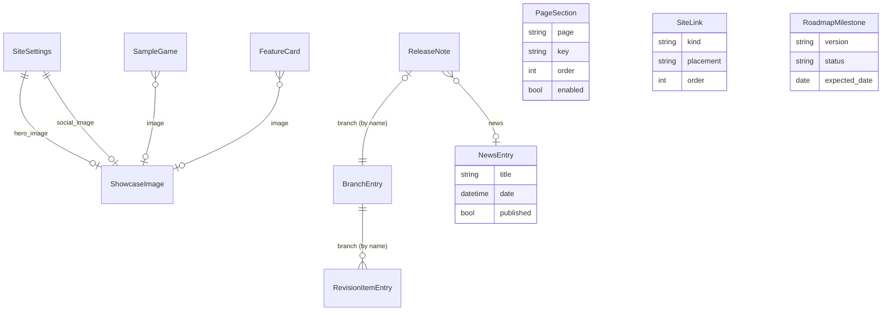

# Home and presentation pages specification

Status: draft, revised 2026-10-18. Target: OwlDelivery 0.5.0. Scope: two public pages of
[owl.argawaen.net](https://owl.argawaen.net):

- `/` (**Home**): a short landing page. Today it renders the news list (`delivery.views.news`).
- `/presentation` (**Presentation**, new header tab): the full presentation of Owl Engine.

## Goal

- **Home** answers "what is it, what is new, where do I get it" in one screen: product name and tagline, a
  **Discover** link to the presentation, a download block pointing at the download section, the 3 latest news with a
  link to all news.
- **Presentation** presents **Owl Engine** in one page: pitch, screenshots, features, download, sample games, roadmap,
  how it is built.
- Pitch: *"Owl Engine is the C++ engine that mixes rendering styles in one game: 2D, raycast, voxel, isometric and
  3D, stacked under one HUD, in the editor and in game."*
- **Everything that changes over time is data**, edited in the site admin (`/admin/pages`) or pushed by the engine
  CI through `/api`. Templates hold layout only: no text, image, version, link or list item is written in a template.
  A content change never needs a commit, an image rebuild or a redeploy.

Promotion constraints (maintainer, 2026-10-18):

- Product name **Owl Engine** (the header, footer and `<title>` still say "Owl Game Engine" today: they become data).
- Promotion only through GitHub and this site until v1.0.0: no newsletter, no social feed embed, no tracker.
- Screenshots only, no video field.
- Claude Code is stated openly as a supervised development tool; the code is owned by the maintainer behind a strict
  CI (the "How it is built" section).

Out of scope: comments on these pages, search, analytics, multi-language content, a page builder.

## What exists and is reused

| Existing piece                                  | Use                                                                    |
|-------------------------------------------------|------------------------------------------------------------------------|
| `NewsEntry` (markdownx, `-date`, `content_md`)  | Home "Latest news" block: last 3 entries, truncated render, detail link |
| `BranchEntry` (`stable`, `visible`)             | Picks the latest stable release and the current development version    |
| `RevisionItemEntry` (hash, name, flavor, file)  | Download links per package and platform, size, build date              |
| `revision_utils` (`get_revision_info`, doc URL) | Grouping per name and flavor, `media/documentation/<branch>/` link     |
| `/api` (HTTP Basic, `push`, `push_doc`)         | Extended with `push_screenshot` and `push_release` (see *CI and API*)  |
| `api.py` client script                          | New sub-commands only; existing arguments unchanged (CI compatibility) |
| Admin pages (`SUBPAGES`, tab bar, accordions)   | New **Pages** tab, same patterns as `admin/news.html`                  |
| CSS tokens and BEM components                   | `card`, `btn`, `badge`, `pkg-list`, `flavor-grid`, `empty-state`, ...  |
| `accordion.js`, `mobile-nav.js`                 | Unchanged; one small `gallery.js` for the lightbox                     |

Facts the design depends on:

- The engine CI (`ci/actions/publish_package.py`) pushes with `branch` = version (`0.3.0`), `hash` = short git hash,
  `name` = `Owl Engine` (`rev_type` `e`) or `Owl Nest` (`a`), `flavor_name` = platform words of the archive
  (`linux glibc_2.43 x64`, `windows x64`). `push_doc` extracts the docs into `documentation/<version>/`.
- `BranchEntry.date` is bumped by **every** push, so it is not a release date: the release date is the build date of
  the revision offered (`get_revision_date(hash)`), unless a `ReleaseNote` gives one.
- Migrations are **not committed**: `entrypoint.py` runs `makemigrations` + `migrate` at start-up and keeps the files
  in `/app/data/migrations/`. Hand-written data migrations would clash with the generated numbering, so seeding is a
  management command (see *Migrations and seeding*).
- The site is English only (`LANGUAGE_CODE = "en-us"`, every UI string in English) but `base.html` declares
  `<html lang="fr">`: a bug to fix in this work.
- No `CACHES` setting: Django uses a per-process `LocMemCache`, and Gunicorn runs 4 workers.
- The delivery code changes rows through `save()` / `delete()` only (no `QuerySet.update()` on the models below,
  checked 2026-10-18), so model signals see every change.
- Dark theme only (`tokens.css`), breakpoints 480 / 768 / 1024 / 1280 px.
- The project roadmap and the release history live in the `README.md` "Roadmap" section; there is no `ROADMAP.md`
  nor `CHANGELOG.md` yet (see *Delivery plan*, step 0).
- No test suite exists yet in the repository.

## Navigation and URLs

| URL             | Name           | View                         | Note                                     |
|-----------------|----------------|------------------------------|------------------------------------------|
| `/`             | `index`        | `home` (new)                 | Landing page                             |
| `/presentation` | `presentation` | `presentation` (new)         | Full presentation                        |
| `/news`         | `news`         | `news` (unchanged)           | Only URL of the news list from now on    |
| `/branches`     | `branches`     | `branches` (unchanged)       | Label **Downloads** in the navigation    |

- Header navigation, in order: **Presentation**, News, **Downloads** (the current "Revisions" entry, label only),
  **Docs** (latest stable docs URL, hidden when none), Admin. The brand link keeps pointing at `/`. The same entries
  go in the mobile navigation. Entries stay in `base.html` (they are structure); their labels are not product content.
- `page` context values: `home`, `presentation` (new, for the active tab), `news`, `revisions`, `admin`.
- `base.html` brand name, footer brand, `<title>` and meta description come from a context processor
  (`delivery.context_processors.site`) reading `SiteSettings`, so every page says **Owl Engine**.

## Home page (`/`)

Fixed hero, then sections in default order. Order, visibility, title and intro of each section are `PageSection`
rows with `page="home"`.

| # | Section (`key`) | Content                                                                                               | Source                                |
|---|-----------------|-------------------------------------------------------------------------------------------------------|---------------------------------------|
| — | hero            | Product name (the page `<h1>`), tagline, hero image (thumbnail), **Discover** button → `/presentation` | `SiteSettings`, `ShowcaseImage`       |
| 1 | `download`      | Latest release version and date, **Download** button → `/presentation#release`, "All downloads" → `/branches` | Derived release + `ReleaseNote` |
| 2 | `news`          | Title "Latest news", the 3 latest published news (title, date, truncated content), "All news" → `/news` | `NewsEntry`                         |

- The Discover button label is `SiteSettings.cta_discover_label`; the hero can also hold a second, smaller
  "Discover" link inside the `download` intro if the maintainer writes one (markdown), nothing is hard-coded.
- The `download` block shows **no** per-platform button: it redirects to the download section of the presentation,
  which stays the single place where packages are listed. Its button reads "Download v0.3.0"
  (`cta_download_label` + version).
- The number of news is `SiteSettings.news_count` (default 3). Unpublished news are not counted.

## Presentation page (`/presentation`)

Sections in default order. Order, visibility, title and intro of every section after the hero are `PageSection` rows
with `page="presentation"`.

| # | Section (`key`) | Content                                                                                    | Source                           |
|---|-----------------|--------------------------------------------------------------------------------------------|----------------------------------|
| — | hero            | Product name (the page `<h1>`), pitch, hero screenshot, up to 3 call-to-action buttons     | `SiteSettings`, `ShowcaseImage`  |
| 1 | `gallery`       | Screenshot grid with captions, lightbox on click                                           | `ShowcaseImage` (in gallery)     |
| 2 | `features`      | "Why Owl Engine" cards: icon, title, short markdown, optional link                         | `FeatureCard`                    |
| 3 | `release`       | Latest release: version, date, highlights, download buttons per package and platform, docs | Derived + optional `ReleaseNote` |
| 4 | `samples`       | Sample games: image, title, "inspired by", short text, status badge, link                  | `SampleGame`                     |
| 5 | `roadmap`       | Current milestone and the next ones: version, goal, expected date, status, highlights      | `RoadmapMilestone`               |
| 6 | `about`         | "How it is built": one maintainer, Claude Code as a supervised tool, strict CI             | `PageSection.intro` (markdown)   |
| 7 | `links`         | Link band: GitHub, documentation, changelog, roadmap, downloads                            | `SiteLink` (placement `band`)    |

- The section `id` is its key, so `/presentation#release` is the download section linked from the home page; the
  anchor stays valid when the section is reordered. When `release` is disabled, the home `download` button falls back
  to `/branches`.
- News are not repeated on this page (they are on the home page and `/news`).

### Release block rules

Shared by the home `download` block, the presentation `release` block, the JSON-LD and the `release_info` API action,
in a new `delivery/release_utils.py` (`parse_version`, `get_latest_release`, `get_dev_build`).

- **Latest release** = the visible `BranchEntry` with `stable=True` whose name has the highest version (parse
  `MAJOR.MINOR.PATCH` into an integer tuple; names that do not parse sort last, then by date).
- Offered revision = the newest hash of that branch (`get_revision_hashes(branch)[0]`); its items grouped by `name`
  (Owl Engine = SDK, Owl Nest = editor), one button per flavor.
- Button label = platform derived from `flavor_name`: OS = first word (`linux` → Linux, `windows` → Windows),
  architecture = last word (`x64`, `arm64`); the middle words (`glibc_2.43`) go to a `title` / small print. Each
  button shows the size (`get_pretty_size_display`) and links to `package.url`.
- Below the buttons: "All files and older versions" → `revisions/<branch>`; "Documentation" → doc URL of the branch
  when it exists; "Changelog" → `ReleaseNote.changelog_url` or the `SiteLink` of kind `changelog`.
- **Development build** line (optional, `SiteSettings.show_dev_build`): the newest visible non-stable branch whose
  version is above the latest release (e.g. `0.4.0`), with hash, build date and a link to its revision page; clearly
  labelled "development build, not a release". Presentation page only.

### Roadmap block rules

- Shows the milestone with status `in_progress` (or the first `planned` one), the next `roadmap_teaser_count` planned
  ones and, when present, the `v1.0.0` milestone flagged `is_target` ("Owl Engine 1.0 — expected 2027-10-31").
- Released milestones are not shown (the release block covers them); a link goes to the full roadmap page of the
  docs.

## Data model

All new models live in the `delivery` app (it owns the public pages, `perms_utils` and the admin tab bar), in a
`delivery/models_pages.py` imported by `models.py`.

Common conventions:

- `order` (`PositiveIntegerField`, default 0) + `Meta.ordering = ["order", "pk"]` on every ordered list.
- `published` (`BooleanField`, default `True` for admin-created rows, `False` for CI-created images) = draft flag.
  Drafts are visible only in the preview (`?preview=1` on `/` or `/presentation`, for a user who can edit the pages).
- `updated` (`DateTimeField(auto_now=True)`) on every model, used by the admin lists.
- Markdown fields are `MarkdownxField`, rendered with `markdownify` like `NewsEntry` (same extensions:
  `extra`, `codehilite`).
- Images are `ImageField` (Pillow is already a dependency) with `width_field` / `height_field`, stored under
  `MEDIA_ROOT/pages/`; on save a WebP thumbnail (640 px wide) is generated beside the original; the upload name gets
  an 8-character content hash (`pages/gallery/<key>-<hash>.png`) so URLs change when the image changes.

### `SiteSettings` (singleton, `pk=1`)

| Field                  | Type                     | Default / note                                                    |
|------------------------|--------------------------|-------------------------------------------------------------------|
| `site_name`            | Char 60                  | `Owl Engine` — header, footer, `<title>`, `og:site_name`          |
| `tagline`              | Char 120                 | Under the name in both heroes                                     |
| `pitch`                | Markdownx                | Presentation hero paragraph                                       |
| `meta_description`     | Char 160                 | `<meta name="description">`, `og:description`                     |
| `hero_image`           | FK `ShowcaseImage`, null | `SET_NULL`; both heroes; fallback: first published gallery image  |
| `social_image`         | FK `ShowcaseImage`, null | `SET_NULL`; `og:image`; fallback: `static/img/logo_owl.png`       |
| `cta_discover_label`   | Char 40                  | `Discover` → `/presentation` (home hero)                          |
| `cta_download_label`   | Char 40                  | `Download` → `#release` (presentation hero, home download block)  |
| `cta_docs_label`       | Char 40                  | `Documentation` → latest docs (presentation hero)                 |
| `cta_github_label`     | Char 40                  | `GitHub` → `SiteLink` kind `github`; empty label hides the button |
| `news_count`           | PositiveSmallInt         | 3 (home "Latest news")                                            |
| `roadmap_teaser_count` | PositiveSmallInt         | 2                                                                 |
| `show_dev_build`       | Bool                     | `True`                                                            |
| `footer_text`          | Char 200                 | Replaces the hard-coded "© Argawaen — All rights reserved."       |
| `content_version`      | PositiveInt              | Cache key, bumped by signals only (see *Caching*), not editable   |

`SiteSettings.load()` = `get_or_create(pk=1)` with the defaults of the seed; `delete()` is refused.

### `PageSection`

| Field     | Type                 | Note                                                                                       |
|-----------|----------------------|--------------------------------------------------------------------------------------------|
| `page`    | Char 12, choices     | `home`, `presentation`                                                                     |
| `key`     | Char 20              | `home`: `download`, `news`; `presentation`: `gallery`, `features`, `release`, `samples`, `roadmap`, `about`, `links` |
| `title`   | Char 80              | Section `<h2>`; the `id` anchor is the key                                                 |
| `intro`   | Markdownx, blank     | Short text under the title (the whole body for `about`)                                    |
| `enabled` | Bool                 | Hides the section                                                                          |
| `order`   | PositiveInt          | Section order after the hero, within its page                                              |

`unique_together = ("page", "key")`. The `(page, key)` set is fixed in code (`PAGE_SECTIONS` in
`models_pages.py`, one partial template per pair, `delivery/sections/_<page>_<key>.html`); a missing row is created
by the seed command, a row whose pair the code does not know is ignored at render time.

### `ShowcaseImage`

| Field                           | Type                       | Note                                                                                   |
|---------------------------------|----------------------------|----------------------------------------------------------------------------------------|
| `key`                           | Slug 50, unique            | Stable name used by the CI upsert (`hub`, `raycast`, `social_preview`)                 |
| `image`                         | ImageField                 | PNG / JPEG / WebP, max 8 MB, max 3840 px wide                                          |
| `thumbnail`                     | ImageField, editable=False | Generated WebP, 640 px wide                                                            |
| `width`, `height`               | PositiveInt                | Filled by Django (`width_field`, `height_field`), used for `width`/`height` attributes |
| `caption`                       | Char 160                   | Visible `<figcaption>`                                                                 |
| `alt_text`                      | Char 200, required         | Describes the picture for screen readers (not a copy of the caption)                   |
| `style_tag`                     | Char 20, choices, blank    | `2d`, `raycast`, `voxel`, `isometric`, `3d`, `hud`, `editor`: small badge              |
| `in_gallery`                    | Bool                       | `False` for the social preview or images used only by cards                            |
| `source`                        | Char 10, choices           | `admin` or `ci` (set by the API, shown in the admin list)                              |
| `published`, `order`, `updated` | —                          | Common conventions                                                                     |

### `FeatureCard`

| Field                           | Type                     | Note                                                        |
|---------------------------------|--------------------------|-------------------------------------------------------------|
| `title`                         | Char 80                  |                                                             |
| `icon`                          | Char 40, blank           | Material Symbols name (`layers`, `edit_square`, `verified`) |
| `body`                          | Markdownx                | 1–3 sentences; rendered in full (no truncation)             |
| `image`                         | FK `ShowcaseImage`, null | Optional illustration                                       |
| `link_label`, `link_url`        | Char 40, URL 300, blank  | Optional "Learn more" (docs page, GitHub file)              |
| `published`, `order`, `updated` | —                        |                                                             |

### `SampleGame`

| Field                           | Type                     | Note                                                                     |
|---------------------------------|--------------------------|--------------------------------------------------------------------------|
| `title`                         | Char 80                  |                                                                          |
| `slug`                          | Slug 80, unique          |                                                                          |
| `inspired_by`                   | Char 80, blank           | "Breakout / Arkanoid"                                                    |
| `summary`                       | Markdownx                | 1–3 sentences                                                            |
| `exercises`                     | Char 160, blank          | "2D, physics, HUD, sound, gamepad" (shown as small print)                |
| `image`                         | FK `ShowcaseImage`, null | Fallback: a neutral placeholder block with the `style_tag` icon          |
| `link_url`                      | URL 300, blank           | GitHub folder `samples/<game>` or a news entry                           |
| `status`                        | Char 12, choices         | `planned`, `in_progress`, `playable` (on `main`), `released`             |
| `target_version`                | Char 20, blank           | `0.4.0`; shown in the badge ("Planned for v0.5.0", "Released in v0.4.0") |
| `published`, `order`, `updated` | —                        |                                                                          |

### `RoadmapMilestone`

| Field                  | Type             | Note                                                       |
|------------------------|------------------|------------------------------------------------------------|
| `version`              | Char 20, unique  | `0.5.0`, `1.0.0`; sorted by parsed version, not by `order` |
| `goal`                 | Char 300         | One sentence                                               |
| `highlights`           | Markdownx, blank | 3–5 bullets                                                |
| `expected_date`        | Date, null       | "Expected 2027-01-31"                                      |
| `status`               | Char 12, choices | `planned`, `in_progress`, `released`                       |
| `is_target`            | Bool             | The 1.0 milestone always shown last                        |
| `link_url`             | URL 300, blank   | Design page of the milestone                               |
| `published`, `updated` | —                |                                                            |

### `ReleaseNote` (optional enrichment of the derived release)

| Field                  | Type                 | Note                                                           |
|------------------------|----------------------|----------------------------------------------------------------|
| `branch`               | Char 50, unique      | Matches `BranchEntry.name` (by name, like `RevisionItemEntry`) |
| `title`                | Char 120, blank      | "Owl Engine 0.3.0 — Foundations"                               |
| `release_date`         | Date, null           | Overrides the build date of the revision                       |
| `highlights`           | Markdownx, blank     | Short bullet list                                              |
| `changelog_url`        | URL 300, blank       | Anchor of the changelog page                                   |
| `news`                 | FK `NewsEntry`, null | `SET_NULL`; "Read the announcement"                            |
| `published`, `updated` | —                    |                                                                |

### `SiteLink`

| Field                           | Type             | Note                                                                                      |
|---------------------------------|------------------|-------------------------------------------------------------------------------------------|
| `label`                         | Char 40          |                                                                                           |
| `kind`                          | Char 12, choices | `custom`, `github`, `docs_latest`, `downloads`, `news`, `changelog`, `roadmap`            |
| `url`                           | URL 300, blank   | Required for `custom` / `github` / `changelog` / `roadmap`; ignored for the derived kinds |
| `icon`                          | Char 40, blank   | Material Symbols name                                                                     |
| `placement`                     | Char 10, choices | `band` (presentation section `links`), `footer`                                           |
| `published`, `order`, `updated` | —                |                                                                                           |

Derived kinds resolve at render time: `docs_latest` → doc URL of the latest release branch (hidden when none),
`downloads` → `branches`, `news` → `news`. A link that resolves to nothing is not rendered. A link wanted in both
placements is two rows.

### Change to `NewsEntry`

- Add `published = BooleanField(default=True)` (existing rows stay visible). The news list, the detail page and the
  home block filter on it; the admin news form gets the checkbox. This gives news a draft state, consistent with the
  rest of the page content.

## Admin pages

New tab **Pages** in `SUBPAGES` (`name="pages"`, `url="a_pages"`), visible with `can_see_pages_admin` (new helper in
`perms_utils.py`: any `change_*` permission of the page models), and added to `can_see_admin`.

| URL                                  | Name               | Content                                                                                                                                                             |
|--------------------------------------|--------------------|---------------------------------------------------------------------------------------------------------------------------------------------------------------------|
| `admin/pages`                        | `a_pages`          | Overview: one accordion per block (Site texts, Sections, Gallery, Features, Samples, Roadmap, Release notes, Links), each with a `data-table` list and an "Add" form |
| `admin/pages/<kind>/<int:pk>`        | `a_pages_detail`   | Edit form of one row (like `admin/news_detail.html`), image preview                                                                                                 |
| `admin/pages/<kind>/<int:pk>/action` | `a_pages_action`   | POST only: `delete`, `publish`, `unpublish`, `up`, `down`                                                                                                           |
| `admin/pages/settings`               | `a_pages_settings` | `SiteSettings` form (`content_version` excluded)                                                                                                                    |

- `<kind>` is a whitelist (`section`, `image`, `feature`, `sample`, `milestone`, `release`, `link`) mapped to a model
  and a `ModelForm` in `forms.py`; one generic view pair, no per-model view duplication.
- The Sections table is grouped by page (Home, then Presentation); up / down swap only within the same page; sections
  cannot be added or deleted from the admin (fixed key set), only edited, enabled / disabled and reordered.
- Forms: `INPUT_CSS` on every widget, markdownx widget for markdown fields with `{{ form.media }}`,
  `enctype="multipart/form-data"` where an image is uploaded, rendered through `includes/form_field.html`.
- Table rows: thumbnail (images, samples), title, status badge (`badge--success` published, `badge--neutral` draft),
  source (`ci` / `admin`), updated date, action buttons (up, down, publish toggle, delete with `btn--danger`), row
  clickable to the detail page (same pattern as the news table).
- Reordering by up / down buttons that swap `order` with the neighbour (no drag-and-drop JS).
- Two **Preview** buttons open `/?preview=1` and `/presentation?preview=1` (drafts shown with a dashed outline and a
  "Draft" badge).
- Redirects use `redirect("a_pages")` (rule of `.claude/rules/django.md`), not `HTTP_REFERER`.
- `admin/users`: two extra permission toggles. "Pages edit" grants or removes every add / change / delete
  permission of the page models at once; "Pages push" grants or removes the CI push rights
  (`delivery.add_showcaseimage`, `delivery.add_releasenote`).
- Django admin (`/staff/`, `ENABLE_STAFF`): register every new model (`MarkdownxModelAdmin` where markdown), as a
  fallback editor only.

## CI and API

New `/api` actions, same authentication as `push` (HTTP Basic or session), same maintenance lock check, same
plain-text responses (`GOOD.` / `WARNING:` / `ERROR`), same 200 / 201 / 403 / 406 codes.

| Action            | Permission                   | Fields                                                                                                   | Behaviour                                                                                                                                                                          |
|-------------------|------------------------------|----------------------------------------------------------------------------------------------------------|------------------------------------------------------------------------------------------------------------------------------------------------------------------------------------|
| `push_screenshot` | `delivery.add_showcaseimage` | `key` (required), `package` (file), optional `caption`, `alt_text`, `style_tag`, `in_gallery`, `publish` | Upsert by `key`. New key: created with `source=ci`, `published=publish` (default `false`). Existing key: image replaced, other fields updated only when sent; admin edits are kept |
| `push_release`    | `delivery.add_releasenote`   | `branch` (required), optional `title`, `release_date`, `highlights`, `changelog_url`                     | Upsert `ReleaseNote` by branch; does not touch `BranchEntry.stable` (the maintainer flips it)                                                                                      |
| `release_info`    | authenticated                | —                                                                                                        | Plain-text dump of the derived release (version, hash, flavors) for a CI check after publication                                                                                   |

- Screenshots are small (≈ 50–300 KB), so they go through the direct upload path; the Nginx `/upload` location does
  not need new `upload_pass_form_field` entries. A file above 100 MB is refused.
- `api.py` gains the sub-commands `push_screenshot` and `push_release`; existing sub-commands and arguments are
  unchanged.
- Engine side (follow-up in the Owl repository, not this PR): a `PublishShowcase` CI action pushing
  `doc/images/showcase/*.png` (keys = file stems, the social preview with `in_gallery=false`) after the headless
  capture, and `PublishPackage` on a release tag calling `push_release` with the date and the changelog anchor.
- Nothing else is pushed automatically: features, samples and roadmap texts are editorial content, edited in the
  admin. A `push_roadmap` fed from `doc/pages/roadmap.md` is a possible later step, not planned.

## Caching

- Context data of both pages is cached per block in the default cache under
  `pages:<page>:<block>:<content_version>`, 10 minutes timeout (safety net).
- `content_version` is bumped by `post_save` / `post_delete` signals on every page model (`SiteSettings` included),
  on `NewsEntry`, `BranchEntry` and `RevisionItemEntry`. Each request reads the singleton (one indexed query), so the
  per-worker `LocMemCache` stays correct across the 4 Gunicorn workers without a shared cache backend.
- The bump is **one atomic SQL update that fires no signal**:
  `SiteSettings.objects.filter(pk=1).update(content_version=F("content_version") + 1)`. Never `settings.save()` in a
  handler: a `post_save` on `SiteSettings` would call itself again.
- `SiteSettings.save()` never writes `content_version` (it saves with `update_fields` = every field but
  `content_version` once the row exists). Otherwise an admin form loaded before a bump would write the old number
  back, and the pages would serve cache entries of that older version for up to 10 minutes.
- The counter only grows; old keys simply expire. Signals are connected in `DeliveryConfig.ready()`.
- Whole-page caching is not used: the header depends on the user (login, Admin link). Preview requests bypass the
  cache.
- Images: Nginx serves `/media/` from a whitelist (`packages/`, `documentation/`, `markdownx/`); this work adds
  `location /media/pages/ { expires 30d; }` to `server/config/http.d/Django_server.conf` (safe because file names
  carry a content hash). Package files keep their current headers.
- Target: each page under 30 queries cold, under 5 warm; total image weight of the first screen under 500 KB
  (thumbnails, `loading="lazy"` below the hero, hero image `fetchpriority="high"`).

## Fallbacks

| Page         | Block    | Empty / failure case               | Behaviour                                                                                                          |
|--------------|----------|------------------------------------|--------------------------------------------------------------------------------------------------------------------|
| both         | Hero     | No `SiteSettings` row              | Created on first access with the seed defaults                                                                     |
| both         | Hero     | No hero image                      | First published gallery image; none → logo on a neutral panel                                                      |
| home         | Download | No stable visible branch           | Version line hidden, button "All downloads" → `/branches` only; no branch at all → section hidden                  |
| home         | News     | No published news                  | Section hidden                                                                                                     |
| presentation | Gallery  | No published image                 | Section hidden                                                                                                     |
| presentation | Features | No published card                  | Section hidden                                                                                                     |
| presentation | Release  | No stable visible branch           | Development build shown alone with its warning; none at all → "No release yet" `empty-state` with a link to GitHub |
| presentation | Release  | A package file missing on disk     | Button kept, size "(void)" (existing behaviour), logged as a warning                                               |
| presentation | Release  | No docs for the branch             | Docs button hidden                                                                                                 |
| presentation | Samples  | No published sample                | Section hidden                                                                                                     |
| presentation | Samples  | Sample without image               | Placeholder block with the icon of its style                                                                       |
| presentation | Roadmap  | No milestone                       | Section hidden                                                                                                     |
| presentation | Links    | Derived link resolves to nothing   | Link not rendered; section hidden when no link left                                                                |
| both         | Any      | Exception while building one block | Block skipped and logged (`logger.exception`), the rest of the page renders                                        |
| both         | OG image | No social image                    | `static/img/logo_owl.png` (absolute URL)                                                                           |

## Responsive behaviour

New CSS classes go into `pages.css` (BEM blocks `page-hero`, `page-section`, `home-download`, `home-news`,
`pres-gallery`, `pres-features`, `pres-release`, `pres-samples`, `pres-roadmap`, `pres-links`), using only
`tokens.css` variables; no new colour. `gallery.js` is loaded through `` on the
presentation page only.

| Block                  | < 480 px                                 | 480–767 px        | 768–1023 px                 | ≥ 1024 px                        |
|------------------------|------------------------------------------|-------------------|-----------------------------|----------------------------------|
| Hero (both)            | Stacked: text, buttons full width, image | Stacked           | Text and image side by side | Side by side, `--text-4xl` title |
| Home download          | Stacked, button full width               | Stacked           | Version and buttons inline  | Version and buttons inline       |
| Home news              | 1 column                                 | 1 column          | 3 columns                   | 3 columns                        |
| Presentation gallery   | 1 column                                 | 2 columns         | 2 columns                   | 3 columns (6 images = 2 rows)    |
| Presentation features  | 1 column                                 | 1 column          | 2 columns                   | 3 columns                        |
| Presentation release   | Buttons stacked full width               | `flavor-grid` 2   | `flavor-grid` 3             | Packages side by side            |
| Presentation samples   | 1 column                                 | 2 columns         | 2 columns                   | 3 columns                        |
| Presentation roadmap   | Vertical timeline                        | Vertical timeline | Horizontal row of cards     | Horizontal row of cards          |

- Images keep a 16:9 box (`aspect-ratio`) with `object-fit: cover`; the lightbox shows the original uncropped.
- Spacing on the 4 px scale (`--sp-*`), sections separated by `--sp-12` (`--sp-8` under 768 px), container
  `--container-max`.
- `prefers-reduced-motion` keeps the existing rule; the lightbox opens without animation then. The jump to
  `#release` uses `scroll-behavior: smooth` only without reduced motion.

## Accessibility

- One `<h1>` per page (the product name in the hero; both views pass no `title`, so `base.html` renders no page
  header), one `<h2>` per section, `<h3>` per card; sections are `<section aria-labelledby>`.
- The Discover and Download buttons are links (`<a class="btn">`), not buttons, with explicit text
  ("Discover Owl Engine", "Download v0.3.0").
- `alt_text` required on every image; the caption is a `<figcaption>`, not a duplicate alt; decorative icons get
  `aria-hidden="true"`.
- Lightbox: native `<dialog>` (focus trap, Escape closes), previous / next buttons with labels, focus returns to the
  thumbnail; every thumbnail is a real link to the original image, so it works without JavaScript.
- Download buttons carry text (package, platform, size), never an icon alone; the archive format is in the label.
- Status badges are text ("Planned", "Released"), not colour only.
- Contrast: `--color-primary` on `--color-neutral-900` is about 5.9:1 (AA for text); text on a primary button uses
  `--color-primary-dark`.
- Visible focus on every link and button (existing `:focus-visible` styles), skip link "Skip to content" added to
  `base.html`. Active tab marked with `aria-current="page"`.
- `<html lang="en">` in `base.html`.

## Language

- English only, like the rest of the site and the engine repository; no translated content model.
- New template strings that are structure (button "All news", "Development build") may use ``
  (`USE_I18N` is already on) at no cost, but no `.po` files are added.
- Dates use the existing formats (`d/m/Y`).

## SEO and social meta

`base.html` gets a `` filled by both pages (other pages keep defaults from `SiteSettings`).

| Tag                                        | Home                               | Presentation                                   |
|--------------------------------------------|------------------------------------|------------------------------------------------|
| `<title>`                                  | `{{ site_name }} — {{ tagline }}`  | `Presentation — {{ site_name }}`               |
| `meta description`                         | `SiteSettings.meta_description`    | same                                           |
| `link rel="canonical"`                     | `https://<DOMAIN_NAME>/`           | `https://<DOMAIN_NAME>/presentation`           |
| `og:type` / `og:site_name` / `og:url`      | `website` / `site_name` / canonical | same                                          |
| `og:title` / `og:description`              | `site_name` / `meta_description`   | same                                           |
| `og:image` (+ `:width`, `:height`, `:alt`) | Absolute URL of `social_image` (1280×640, `social_preview.png`) | same              |
| `twitter:card`                             | `summary_large_image`              | same                                           |
| JSON-LD                                    | —                                  | `SoftwareApplication` (below)                  |

- JSON-LD `SoftwareApplication`: name, description, `applicationCategory` DeveloperApplication, `operatingSystem`
  "Linux, Windows", `softwareVersion` and `downloadUrl` of the latest release, `license` MIT, `codeRepository` GitHub.
- `robots.txt` (allow all, sitemap URL) and `sitemap.xml` (`django.contrib.sitemaps`: home, presentation, news
  entries, branches) served by Django.
- Absolute URLs built on `DOMAIN_NAME` when it is set (nginx forwards the host without its port): `https` for a
  domain name, `http` for a `host:port` local run; `request.build_absolute_uri` otherwise.

## Migrations and seeding

- Model changes only; `makemigrations` / `migrate` run at container start as today (no migration file committed).
- `python manage.py seed_pages`: idempotent management command, called by `entrypoint.py` after `migrate`. Its rule
  depends on the kind of row, and it **never modifies an existing row**:

| Rows                                                                    | Rule                                                                                             |
|-------------------------------------------------------------------------|--------------------------------------------------------------------------------------------------|
| `SiteSettings`                                                          | Created when `pk=1` is missing                                                                   |
| `PageSection`                                                           | **Per pair**: every `(page, key)` of `PAGE_SECTIONS` missing from the table is created with its seed title, intro and order, even when other rows exist (a section added by a later version appears on the next start) |
| `FeatureCard`, `SampleGame`, `RoadmapMilestone`, `ReleaseNote`, `SiteLink` | **Per table**: the seed rows are created only when the table is empty, so a row the maintainer deleted does not come back |
| `ShowcaseImage`                                                         | Never seeded (see below)                                                                         |

- Seed images: none in the site repository. The gallery is filled by the engine CI (`push_screenshot`) or uploaded in
  the admin; until then the gallery is hidden and the heroes fall back to the logo. `seed_pages --images <dir>`
  (optional) imports `<dir>/*.png` as published images with the seed captions, skipping keys that already exist, for
  a local or first deployment from a checkout of `Owl/doc/images/showcase/`.
- `entrypoint.correct_permission()` adds `MEDIA_ROOT/pages/` to the folders it creates and chowns.

## Tests

`server/scripts/delivery/tests/` (Django `TestCase`, in-memory SQLite, `override_settings(MEDIA_ROOT=<tmp dir>)`),
run inside the container: `docker compose run --rm <service> python manage.py test delivery`.

| Test file                   | Cases                                                                                                                                                                                                                                                                                                 |
|-----------------------------|-------------------------------------------------------------------------------------------------------------------------------------------------------------------------------------------------------------------------------------------------------------------------------------------------------|
| `test_home_view.py`         | `/` renders with an empty database; Discover links to `/presentation`; download button links to `/presentation#release` with the latest version, to `/branches` when `release` is disabled; exactly 3 latest published news and an "All news" link; drafts hidden; one `<h1>`; `/news` lists every news |
| `test_presentation_view.py` | Renders with an empty database (only fallbacks) and with a full seed; drafts hidden; drafts shown with `?preview=1` for an editor only; disabled section absent; section order follows `order`; `id="release"` present; one `<h1>`; active tab                                                         |
| `test_release.py`           | Highest stable version wins over newer date (`0.10.0` > `0.9.0`); non-parsable names sort last; invisible branch ignored; flavor → "Linux arm64"; missing file → "(void)"; docs link only when the folder exists; dev build shown only above the release; `ReleaseNote` date overrides the build date |
| `test_pages_api.py`         | `push_screenshot` creates a draft with `source=ci`; second push replaces the image and keeps the admin caption; missing `key` → 406; no permission → 403; locked server → 406; `push_release` upserts; `release_info` output; existing `push` unchanged                                                |
| `test_pages_admin.py`       | Pages tab visible only with a page permission; create / edit / delete per kind; up / down swap, sections only within their page; sections cannot be deleted; publish toggle; unknown kind → 404; anonymous → redirect                                                                                  |
| `test_pages_cache.py`       | Saving any page model, a news entry or a revision item bumps `content_version` by one; saving `SiteSettings` bumps it once (no recursion); saving a stale `SiteSettings` instance does not lower it; the next render shows the change                                                                  |
| `test_pages_meta.py`        | OpenGraph tags with absolute URLs on both pages; canonical URLs; logo fallback; JSON-LD parses and holds the latest version; `lang="en"`                                                                                                                                                              |
| `test_seed_pages.py`        | Seed on empty tables creates the listed rows; second run changes nothing; edited row not overwritten; a missing `PageSection` pair is added when other sections exist; a deleted feature card does not come back                                                                                       |

Lint: `ruff check` and `ruff format --check` (Poetry dev dependency) on the new Python files.

## Seed content

Texts in English, from the engine `README.md`, `doc/pages/roadmap.md`, `samples/*/README.md` and
`engine_demo/README.md` (2026-10-18).

### Site settings

| Field                  | Value                                                                                                                                                         |
|------------------------|---------------------------------------------------------------------------------------------------------------------------------------------------------------|
| `site_name`            | Owl Engine                                                                                                                                                    |
| `tagline`              | One engine, every rendering style                                                                                                                             |
| `pitch`                | Owl Engine is the C++ engine that mixes rendering styles in one game: 2D, raycast, voxel, isometric and 3D, stacked under one HUD, in the editor and in game. |
| `meta_description`     | Owl Engine: a C++23 game engine and editor mixing 2D, raycast, voxel, isometric and 3D in one game. Linux and Windows.                                        |
| `cta_*_label`          | Discover Owl Engine · Download · Documentation · GitHub                                                                                                       |
| `news_count`           | 3                                                                                                                                                             |
| `roadmap_teaser_count` | 2                                                                                                                                                             |
| `show_dev_build`       | true                                                                                                                                                          |
| `footer_text`          | © Argawaen — Owl Engine is MIT licensed.                                                                                                                      |
| `hero_image`           | image `hub` once pushed                                                                                                                                       |
| `social_image`         | image `social_preview` once pushed                                                                                                                            |

### Sections

| Page         | Order | Key        | Title                 | Intro                                                                                                                                                                                                                                                                                         |
|--------------|-------|------------|-----------------------|-----------------------------------------------------------------------------------------------------------------------------------------------------------------------------------------------------------------------------------------------------------------------------------------------|
| home         | 1     | `download` | Download              | The engine SDK and the Owl Nest editor, for Linux and Windows.                                                                                                                                                                                                                                |
| home         | 2     | `news`     | Latest news           | —                                                                                                                                                                                                                                                                                             |
| presentation | 1     | `gallery`  | Five styles, one game | Scenes of the Engine Demo, rendered headless by the game runner on Vulkan.                                                                                                                                                                                                                    |
| presentation | 2     | `features` | Why Owl Engine        | —                                                                                                                                                                                                                                                                                             |
| presentation | 3     | `release`  | Download              | The engine SDK and the Owl Nest editor, for Linux and Windows.                                                                                                                                                                                                                                |
| presentation | 4     | `samples`  | Sample games          | Small but complete games made with Owl Engine, beside the all-in-one Engine Demo. Open one from the **Sample games** list of the Owl Nest File screen.                                                                                                                                        |
| presentation | 5     | `roadmap`  | Roadmap               | Exit criteria take precedence over dates: a version ships when its criteria hold.                                                                                                                                                                                                             |
| presentation | 6     | `about`    | How it is built       | Owl Engine is developed by one maintainer with Claude Code as a development tool. Every change is reviewed and owned by the maintainer, and goes through a strict CI: unit and scenario tests on Linux x64/arm64 and Windows, sanitizers, clang-tidy, include checks and performance budgets. |
| presentation | 7     | `links`    | Get involved          | Source, issues and discussions live on GitHub.                                                                                                                                                                                                                                                |

### Gallery images (keys expected from the CI)

| Order | Key              | Caption                                                  | Style       | In gallery | Alt text                                                                       |
|-------|------------------|----------------------------------------------------------|-------------|------------|--------------------------------------------------------------------------------|
| 1     | `hub`            | 2D RPG hub: a village with four houses, one per level    | `2d`        | yes        | Top-down pixel-art village with houses, a river and a hero, HUD counter on top |
| 2     | `raycast`        | Raycast level: Wolfenstein 3D E1M1 in first person       | `raycast`   | yes        | First-person view of a stone corridor with doors, minimap in a corner          |
| 3     | `voxel`          | Voxel terrain: walk, run and fly over a procedural world | `voxel`     | yes        | Blocky hills and trees under a blue sky, distance objective in the HUD         |
| 4     | `iso_town`       | Isometric town: build roads and watch the traffic        | `isometric` | yes        | Isometric town with roads, cars, a river and a harbour                         |
| 5     | `platformer`     | 2D platformer: meadow, farm and factory                  | `2d`        | yes        | Side-scrolling level with platforms, coins and an astronaut                    |
| 6     | `main_menu`      | Main menu: one HUD system for every scene                | `hud`       | yes        | Engine Demo main menu with the Owl logo and buttons                            |
| —     | `social_preview` | Owl Engine                                               | —           | no         | Owl Engine logo and four screenshots of the Engine Demo                        |

### Feature cards

| Order | Icon             | Title                 | Body                                                                                                                                                                                   | Link                      |
|-------|------------------|-----------------------|----------------------------------------------------------------------------------------------------------------------------------------------------------------------------------------|---------------------------|
| 1     | `layers`         | Render-style mixing   | 2D batches, tilemaps, a raycaster, voxel terrain, isometric maps and 3D meshes are renderer-stack layers that compose with each other and the HUD, in the editor viewport and in Play. | Renderer docs page        |
| 2     | `edit_square`    | Owl Nest editor       | Scenes, tilemaps, node graphs, animations, HUDs and prefabs with undo/redo and hot reload.                                                                                             | Editor docs page          |
| 3     | `smart_toy`      | Drivable by AI agents | A built-in MCP server lets an AI agent drive Owl Nest through the same editor commands as the user.                                                                                    | MCP server docs page      |
| 4     | `verified`       | Engineering rigour    | Unit and scenario tests, CI on Linux x64/arm64 and Windows, sanitizers, Vulkan validation clean and performance budgets checked against a baseline.                                    | Contributing docs page    |
| 5     | `deployed_code`  | Modern rendering      | OpenGL 4.5 and Vulkan 1.4 backends, Slang shaders compiled to SPIR-V and precompiled at build time.                                                                                    | Architecture docs page    |
| 6     | `account_tree`   | ECS and Lua           | Entity-Component-System on EnTT with parent-child hierarchy, prefabs and Lua 5.5 scripting.                                                                                            | Lua scripting docs page   |
| 7     | `sports_esports` | Physics, sound, input | Box2D 2D physics, OpenAL spatial sound, input actions with gamepad support and a fixed simulation tick.                                                                                | Physics docs page         |
| 8     | `package_2`      | From editor to game   | OBJ, glTF and FBX loading, asset packs and a game runner: export a project as a standalone game.                                                                                       | Getting started docs page |

Docs links point at `media/documentation/<latest>/...` pages; until the URLs are checked, leave `link_url` empty.

### Sample games

| Order | Title                 | Inspired by           | Status     | Target | Published | Summary                                                                                                                                      | Exercises                                      | Image key  |
|-------|-----------------------|-----------------------|------------|--------|-----------|----------------------------------------------------------------------------------------------------------------------------------------------|------------------------------------------------|------------|
| 1     | Breakout              | Breakout / Arkanoid   | `playable` | 0.4.0  | yes       | Five levels on one screen, three lives, bricks of one to three hits and two power-ups.                                                       | 2D, physics, HUD, sound, gamepad               | —          |
| 2     | Sokoban               | Sokoban               | `playable` | 0.4.0  | yes       | Ten levels of rising difficulty, from one crate to five, with undo and saved best scores; levels are painted in the Owl Nest tilemap editor. | Tilemap, undo, saves, level editing            | —          |
| 3     | Wolfenstein mini      | Wolfenstein 3D        | `playable` | 0.4.0  | yes       | Three floors drawn by the raycast renderer: treasure, keys, locked doors, secret walls and an exit elevator on each floor.                   | Raycast, doors, pick-ups, HUD                  | `raycast`  |
| 4     | Mini Transport Tycoon | Mini Motorways / TTD  | `planned`  | 0.5.0  | yes       | Roads, vehicles and a management HUD on the isometric renderer: Owl Engine's main argument.                                                  | Isometric, roads, pathfinding, management HUD  | `iso_town` |
| 5     | Mini Minecraft        | Minecraft             | `planned`  | 0.6.0  | yes       | A finite voxel island: break blocks, collect them, build from a nine-slot hotbar.                                                            | Voxel, build and break, inventory              | `voxel`    |
| 6     | One-room Zelda-like   | The Legend of Zelda   | `planned`  | 0.7.0  | no        | A top-down room with dialogue, enemy AI and 2D lights.                                                                                       | Top-down, dialogue, enemy AI, 2D lights        | —          |
| 7     | Marble or mini kart   | Marble Madness / Kart | `planned`  | 0.7.0  | no        | A small 3D game on Jolt physics and shadows.                                                                                                 | 3D, Jolt physics, shadows                      | —          |
| 8     | Networked Bomberman   | Bomberman             | `planned`  | 0.8.0  | no        | Multiplayer on the deterministic simulation.                                                                                                 | Tilemap, deterministic simulation, multiplayer | —          |

Links: `https://github.com/Silmaen/Owl/tree/main/samples/<breakout|sokoban|wolfenstein>` for the playable ones,
empty for the planned ones. The image keys of the planned games reuse Engine Demo screenshots until a sample has its
own; the playable ones get their screenshots once the engine CI captures them (`sample_breakout`, `sample_sokoban`,
`sample_wolfenstein`).
The seed usually runs before the CI pushes any screenshot: an image created later (`push_screenshot` or
`seed_pages --images`) is linked to the seeded samples waiting for its key, when their image is still empty.

### Roadmap milestones

| Version | Status        | Expected   | Target | Goal                                                                                                                                                                                                                                                 |
|---------|---------------|------------|--------|------------------------------------------------------------------------------------------------------------------------------------------------------------------------------------------------------------------------------------------------------|
| 0.4.0   | `in_progress` | 2026-11-01 | no     | An engine able to carry a Transport Tycoon-like game: isometric renderer on large chunked tile maps with slopes, vehicles on a tile graph, a HUD for management games, gamepad input actions, a fixed simulation tick and an MCP server in Owl Nest. |
| 0.5.0   | `planned`     | 2027-01-31 | no     | A focused 3D core: static meshes, PBR, lights and shadows for 2D, isometric and 3D, render graph, essential post-processing, full 3D editing.                                                                                                        |
| 0.6.0   | `planned`     | 2027-04-15 | no     | Produce content at scale and script games without C++: offline asset pipeline, animation and effects, procedural graphs, tile tools, Lua editor scripts and visual scripting compiled to Lua.                                                        |
| 0.7.0   | `planned`     | 2027-06-30 | no     | The systems that make games — AI, 2D and 3D physics, audio, narrative — on a deterministic simulation with input replay and rewind.                                                                                                                  |
| 0.8.0   | `planned`     | 2027-09-15 | no     | Open Owl Engine to other players, modders and the browser: networked multiplayer, mods, the Web; the 1.0 release candidate.                                                                                                                          |
| 1.0.0   | `planned`     | 2027-10-31 | yes    | A stable engine a third party can rely on: frozen public API, versioned formats, consumable SDK, two showcase games, Linux, Windows and the Web.                                                                                                     |

Highlights of 0.4.0 (markdown bullets): `RendererIsometric` layer with corner heights and 19 slopes; tile-graph
pathfinding and vehicles following roads; HUD overhaul with the `.owlhud` asset and its editor; input actions with a
gamepad; MCP server built into Owl Nest; sample games Breakout, Sokoban and Wolfenstein mini.

### Release notes

| Branch | Title                          | Release date | Highlights                                                                                                             |
|--------|--------------------------------|--------------|------------------------------------------------------------------------------------------------------------------------|
| 0.3.0  | Owl Engine 0.3.0 — Foundations | 2026-10-11   | Every known bug fixed, safety nets, Owl RHI repaired, architecture opened, iteration sped up, Owl Nest made ergonomic. |

### Links

| Order | Kind          | Label         | URL                                                             | Icon         | Placement |
|-------|---------------|---------------|-----------------------------------------------------------------|--------------|-----------|
| 1     | `github`      | GitHub        | https://github.com/Silmaen/Owl                                  | `code`       | band      |
| 2     | `docs_latest` | Documentation | (derived)                                                       | `menu_book`  | band      |
| 3     | `downloads`   | All downloads | (derived)                                                       | `package_2`  | band      |
| 4     | `changelog`   | Changelog     | https://github.com/Silmaen/Owl/blob/main/doc/pages/changelog.md | `history`    | band      |
| 5     | `roadmap`     | Roadmap       | https://github.com/Silmaen/Owl/blob/main/doc/pages/roadmap.md   | `map`        | band      |
| 6     | `custom`      | Issues        | https://github.com/Silmaen/Owl/issues                           | `bug_report` | band      |
| 7     | `github`      | GitHub        | https://github.com/Silmaen/Owl                                  | `code`       | footer    |
| 8     | `custom`      | Site source   | https://github.com/Silmaen/OwlDelivery                          | `code`       | footer    |

## Delivery plan

Each step is one commit on the feature branch, with its tests, its `CHANGELOG.md` line and the docs it touches; the
container build and `python manage.py test delivery` pass after every step.

0. **Changelog and roadmap files.** Move the `README.md` "Roadmap" section into `ROADMAP.md` (what is planned:
   0.5.0 with OAuth, email notifications and these pages) and `CHANGELOG.md` (0.1.0 to 0.4.0 as released, one line
   per change; a "0.5.0 — in development" section with the work merged since 0.4.0: timeouts and upload concurrency,
   `deploy.sh`, `/media` whitelist). `README.md` keeps a link to both. Every later step adds its line to the 0.5.0
   section and removes it from `ROADMAP.md` once delivered.
1. **Foundations.** `models_pages.py`, `NewsEntry.published`, signals and `content_version` rules, `seed_pages` and its
   `entrypoint.py` call, `MEDIA_ROOT/pages/` in `correct_permission()`, `SiteSettings` context processor;
   `base.html`: `lang="en"`, brand and footer from data, skip link. Tests: `test_seed_pages.py`, `test_pages_cache.py`.
2. **Release helpers.** `release_utils.py` (version parsing, latest release, dev build, flavor labels).
   Tests: `test_release.py`.
3. **Home page.** `home` view on `/`, hero with Discover, `download` and `news` sections, news list on `/news` only,
   navigation (Presentation tab, Downloads label, Docs), CSS of the home blocks. Tests: `test_home_view.py`.
4. **Presentation page.** `presentation` view, section partials and fallbacks, CSS, `gallery.js`, meta tags, JSON-LD,
   `robots.txt`, `sitemap.xml`, `location /media/pages/` in Nginx. Tests: `test_presentation_view.py`,
   `test_pages_meta.py`.
5. **Admin Pages tab.** Generic views and forms, users permission toggle, Django admin registration, news
   `published` checkbox. Tests: `test_pages_admin.py`.
6. **API.** `push_screenshot`, `push_release`, `release_info`, `api.py` sub-commands. Tests: `test_pages_api.py`.
7. **Docs.** `README.md` and `CLAUDE.md` (models, URLs, API, admin tab), `ROADMAP.md` emptied of the delivered items.
8. **Follow-up in the Owl repository** (not this PR): `PublishShowcase` CI action and `push_release` on release.
